<!-- ========== BANNER ========== -->

  

  

<!-- ========== ABOUT ========== -->
## 💻 whoami

<!-- ========== RESEARCH ========== -->
## 🔬 What I work on

<table>
  <tr>
    <td width="33%" valign="top">
      <h3 align="center">🔋 Energy materials</h3>
      
Sodium-ion conducting solid electrolytes for safer, next-generation batteries

    </td>
    <td width="33%" valign="top">
      <h3 align="center">⚛️ Simulation</h3>
      
DFT with Quantum ESPRESSO and pymatgen, run on HPC clusters

    </td>
    <td width="33%" valign="top">
      <h3 align="center">🎥 Teaching</h3>
      
Beginner-friendly lectures (like HPC) on the Attack on Scholar channel

    </td>
  </tr>
</table>

<!-- ========== TECH STACK ========== -->
## 🛠️ Tech stack

  

  
  
  
  
  
  
  

<!-- ========== PROJECTS ========== -->
## 🚀 Featured projects

<table>
  <tr>
    <td width="50%" valign="top">
      <h3>🧪 <a href="https://github.com/Urru14/lab-tools">lab-tools</a></h3>
      
Streamlit app with a stoichiometry calculator and XRD plotting tool for solid-state synthesis.

      
      
    </td>
    <td width="50%" valign="top">
      <h3>🌐 <a href="https://attackonscholar.com">Attack on Scholar</a></h3>
      
Tutorials and lectures that make research skills easy for early-career researchers.

      
      
    </td>
  </tr>
  <tr>
    <td width="50%" valign="top">
      <h3>🧮 <a href="https://github.com/Urru14/PHN-643_Numerical-Analysis-Computer-Programming">Numerical Analysis</a></h3>
      
Numerical methods implemented from scratch in Python.

      
    </td>
    <td width="50%" valign="top">
      <h3>☢️ <a href="https://github.com/Urru14/PHN-624_Computational_Nuclear_Physics">Computational Nuclear Physics</a></h3>
      
Computational nuclear physics codes in Fortran.

      
    </td>
  </tr>
</table>

<!-- ========== STATS ========== -->
## 📊 GitHub activity

  
  

  

  <picture>
    <source media="(prefers-color-scheme: dark)" srcset="https://raw.githubusercontent.com/Urru14/Urru14/output/github-snake-dark.svg"/>
    
  </picture>

<!-- ========== LINKS ========== -->

  
  
  
  
  
  

<!-- ========== FOOTER ========== -->

  <i>“Science is a way of thinking much more than it is a body of knowledge.”</i> — Carl Sagan

